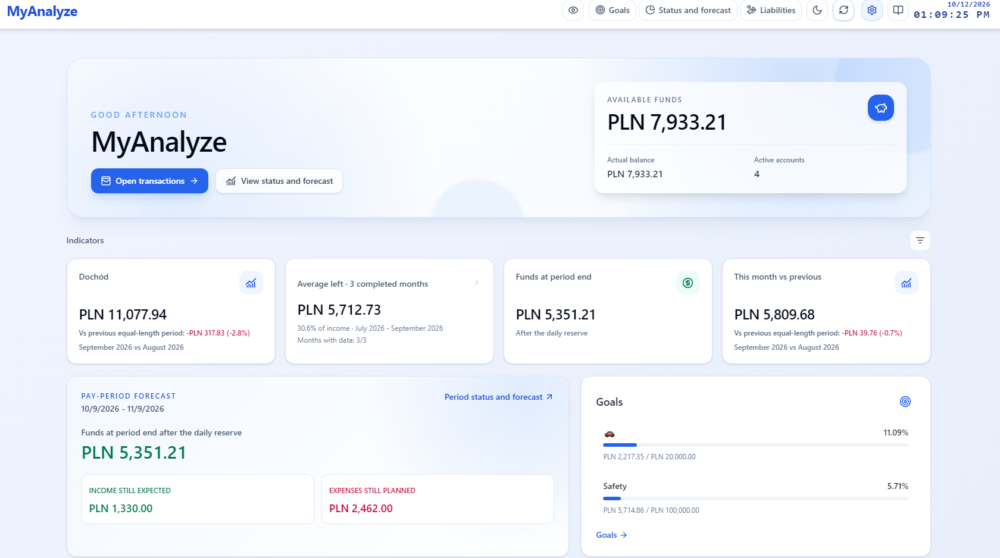
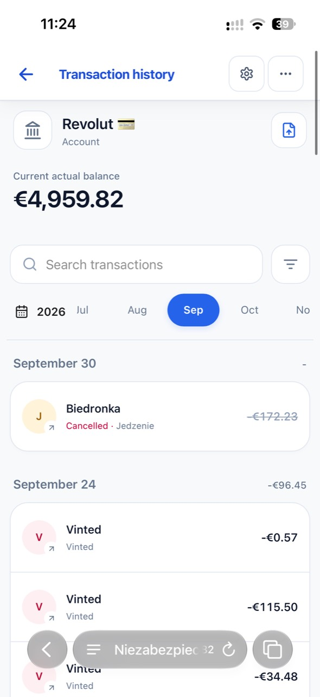
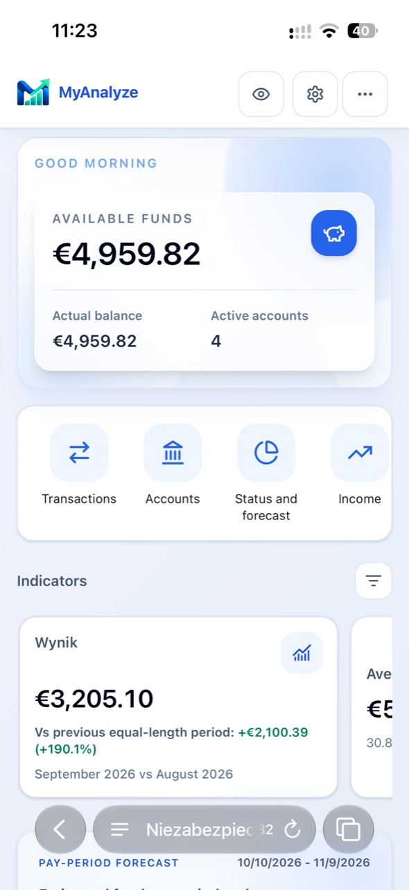
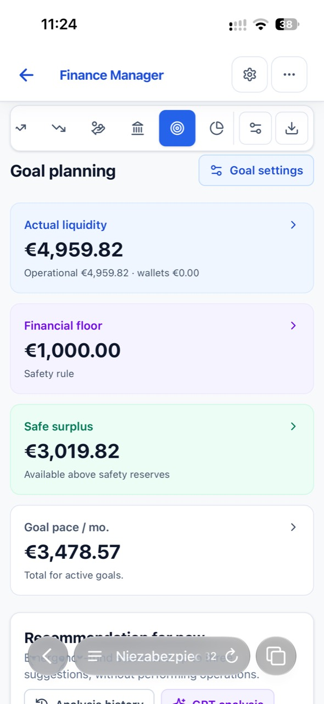
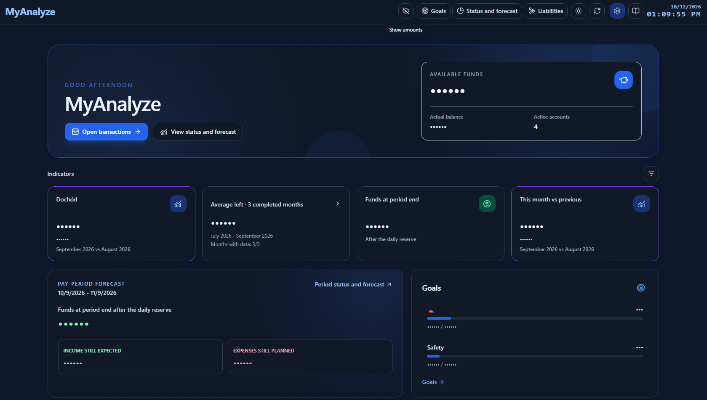
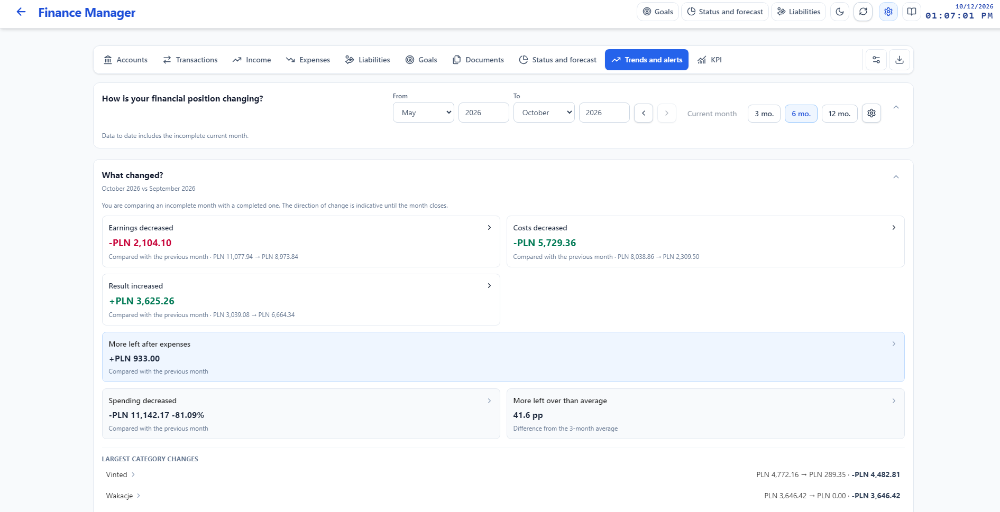
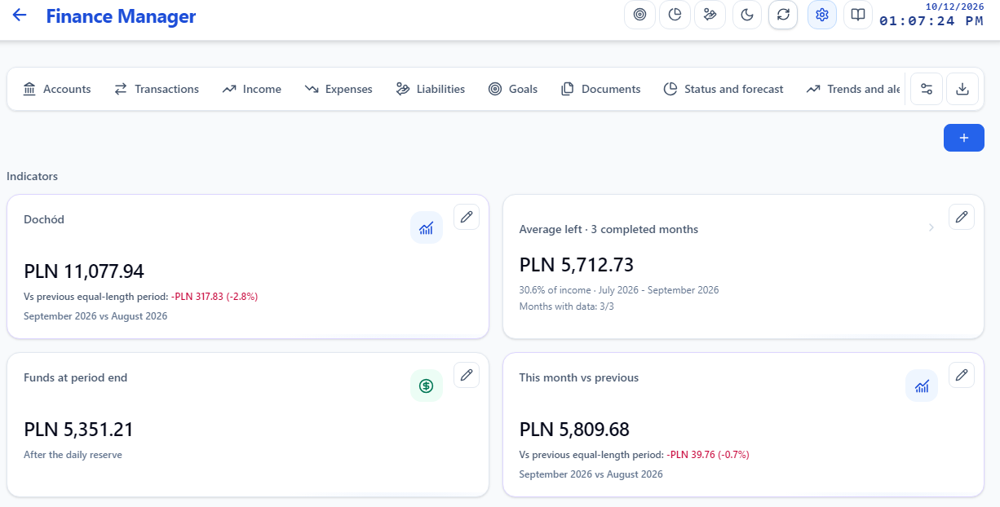

# MyAnalyze

MyAnalyze is a Windows desktop app I built to keep everyday finances clear. It brings accounts, completed transactions, upcoming payments, goals and analysis into one place. Your data stays on your computer.

**[Download MyAnalyze 4.0 for Windows](https://github.com/987p2jnkrb-wq/MyAnalyze-releases/releases/tag/v4.0.0)** · [Previous releases](https://github.com/987p2jnkrb-wq/MyAnalyze-releases/releases) · [How the project evolved](HISTORY.md)

## What you can do

- Keep track of accounts, income, expenses, loans, liabilities and savings goals.
- Import CSV and PDF statements, review matches and correct transactions before saving.
- Compare months, inspect trends and follow the transactions behind each result.
- Plan upcoming payments separately from completed transactions and account balances.
- Create your own KPIs, review spending alerts and explore scenarios.
- Attach documents, make a full backup and use the app in Polish or English.

MyAnalyze is a personal project, built for practical use rather than bank integration. Imported statements do not silently change account balances. The source code is maintained in a private repository; this public repository contains installers and a visual overview of the product.

## New in 4.0: mobile views

MyAnalyze now also has a responsive mobile browser interface: compact transaction history with status indicators, search and month filters, swipeable KPIs and individually selectable spending signals. Customizable shortcuts open Finance Manager tabs, and holding a row lets you rearrange it with smooth feedback.

The mobile interface uses a privately shared instance of the app. The Windows download remains the desktop installer; financial data is not uploaded to a public service.

  
  
  

## Inside the app

### A dashboard that shows what matters now

The opening screen brings together available funds, selected KPIs, the current pay period and goals.

### Changes over time

Month comparisons and trends make it easier to see what changed in income, spending and the result. The current, incomplete month is marked as such.

### KPIs you can adjust

Indicators have their own view. You can add or edit them and open the transactions behind their values.

## Install

Download the Windows x64 installer from the [4.0 release](https://github.com/987p2jnkrb-wq/MyAnalyze-releases/releases/tag/v4.0.0). The release also includes a SHA-256 checksum. Documentation is included in the installer and available from the app.

Before updating from an earlier version, create a full backup in the app. Keep the backup private: it can contain your financial data and documents.

**Earlier versions:** [MyAnalyze 3.0](https://github.com/987p2jnkrb-wq/MyAnalyze-releases/releases/tag/v3.0) and [MyAnalyze 2.0.0](https://github.com/987p2jnkrb-wq/MyAnalyze-releases/releases/tag/v2.0.0) remain available with their original installers and documentation.

Built by Mikołaj Dworak · [mikolajdworak@icloud.com](mailto:mikolajdworak@icloud.com)
