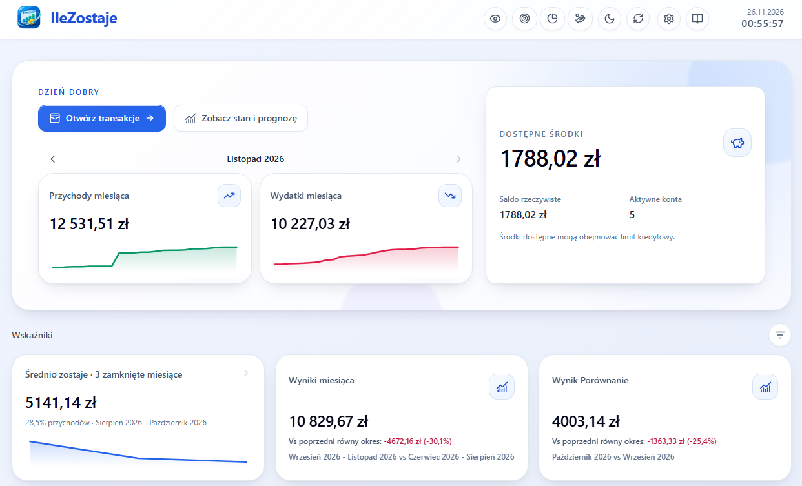
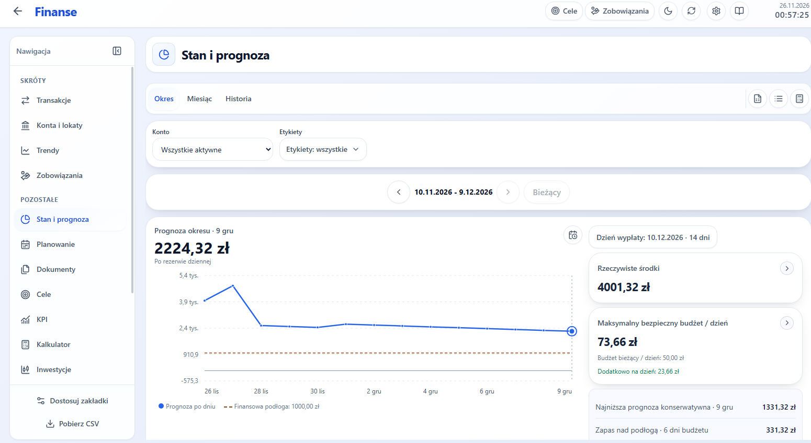

# IleZostaje 1.0

IleZostaje is a personal finance application I built to make everyday finances easier to understand and plan. Import CSV and PDF statements, review transactions before saving, and plan the months ahead. Accounts, goals, spending and forecasts together — without connecting your bank. Your financial data stays on your computer.

**MyAnalyze has evolved into IleZostaje and is now officially published under its new brand on Microsoft Store.**

**[Get IleZostaje on Microsoft Store](https://apps.microsoft.com/detail/9N1M8RZBRRCC)** · [Visit MD Quality](https://mdquality.pl/)

Local financial data · CSV / PDF import · Plan versus actual · Soon Available on macOS too

## Inside the app

  
  

## What you can do

- Track accounts, income, expenses, loans, liabilities and savings goals.
- Import CSV and PDF statements, review matches and correct transactions before saving.
- Compare months, inspect trends and trace the transactions behind each result.
- Plan upcoming payments separately from completed transactions and account balances.
- Configure financial KPIs, review spending alerts and explore scenarios.
- Track investments and retirement savings, including IKE, IKZE and PPK.
- Attach documents, create backups and use the app in Polish or English.

### Responsive mobile interface (dark mode)

  
  

*Mobile previews from the earlier responsive interface.*

## Availability

| Platform | Availability |
| --- | --- |
| Windows | [Microsoft Store](https://apps.microsoft.com/detail/9N1M8RZBRRCC) |
| macOS | Coming soon |
| iOS | Coming soon |

The current Windows application is distributed through Microsoft Store. The responsive mobile browser interface is available through a privately shared instance of the desktop app; it is not a native mobile app.

## About this project

What started as MyAnalyze is now IleZostaje, an independent product and portfolio project. The source code is maintained in a private repository. This public repository retains its original name and address to preserve existing portfolio and CV links.

- [MD Quality — product and portfolio](https://mdquality.pl/)
- [Privacy policy (EN)](https://mdquality.pl/ilezostaje/privacy/)
- [Polityka prywatności (PL)](https://mdquality.pl/pl/ilezostaje/privacy/)
